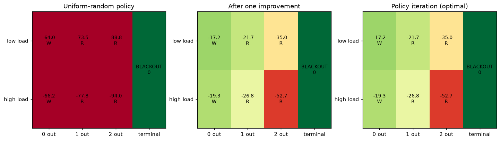

# Policy Iteration on a Power-Grid MDP

INFO 7375 Self-Improving AI, Assignment 2: Policy Improvement.

Same domain as week 1 ([SPADE environment designer for Grid2Op](https://github.com/szhao1025/spade-grid2op)):
power-grid operations. This repo designs a **minimal MDP** for that domain and re-implements the lecture
notebook *Self-Improving AI - Week 2: Policy Iteration* (Sutton & Barto, Ch. 4) for it:

1. a **SQL schema** for the domain,
2. the **SQLAlchemy** tables for that schema,
3. **policy evaluation** and **policy improvement / policy iteration** experiments (plus value iteration as an
   independent check, and a domain experiment on the blackout penalty).

**Notebook:** [`policy_iteration_grid.ipynb`](policy_iteration_grid.ipynb) (executed, with all outputs).

## The MDP

An operator watches a transmission corridor in which up to two lines can be out of service.

| | |
|---|---|
| **States** | `(lines_out in {0,1,2}, load in {low, high})`: 6 operating states, plus an absorbing **BLACKOUT** |
| **Actions** | `wait`, `repair` (crew: a line returns w.p. 0.6), `redispatch` (halves trip risk), `shed` (cuts trip risk to 10%) |
| **Dynamics** | another line trips w.p. `base(load) x multiplier(action) x (1 + 0.5 lines_out)` with base 0.05 / 0.25; a trip with 2 lines already out causes BLACKOUT; demand switches w.p. 0.3 |
| **Reward** | `-(action cost) - lines_out` per step (costs 0 / 1 / 2 / 6), and `-100` on the transition into BLACKOUT |
| **Discount** | 0.95 |

## How it differs from the lecture's Gridworld

| Lecture (Gridworld) | This project (power grid) |
|---|---|
| Deterministic moves: one `transition` row per (state, action) | **Stochastic** outcomes: one row per successor with a `probability`; primary key `(state, action, next_state)`, and a query checks that each distribution sums to 1 |
| States are grid cells (`cell` table) | States carry `lines_out` and a `load_level`; actions carry cost and effect parameters |
| gamma = 1, step reward -1 | gamma = 0.95, action costs, a line-outage cost, and a blackout penalty on entering the terminal state |
| q-backup: `r + v(s')` | `GROUP BY (state, action)` of `sum p (r + gamma v(s'))` in SQL |
| Exact evaluation: `(I - P) v = r` | `(I - gamma P_pi) v = r_pi` (non-singular for every policy thanks to discounting) |
| Optimal reference: Manhattan distance | Optimal reference: **value iteration** (Manhattan distance has no analogue here) |

## Results

| state | always wait | uniform random | after 1 improvement | policy iteration | value iteration |
|---|---:|---:|---:|---:|---:|
| 0 out / low | -56.46 | -63.98 | -17.21 | -17.21 | -17.21 |
| 0 out / high | -62.87 | -66.20 | -19.33 | -19.33 | -19.33 |
| 1 out / low | -77.38 | -73.53 | -21.73 | -21.73 | -21.73 |
| 1 out / high | -83.81 | -77.79 | -26.84 | -26.84 | -26.84 |
| 2 out / low | -92.24 | -88.79 | -35.03 | -35.03 | -35.03 |
| 2 out / high | -97.59 | -93.96 | -52.74 | -52.74 | -52.74 |

- **Policy evaluation:** iterative SQL backups converge geometrically to the linear-solve values (299 sweeps for
  the uniform policy, 125 for always-wait, tolerance 1e-9).
- **Policy improvement:** one greedy step from the uniform-random policy is already optimal here; policy
  iteration stops after 2 iterations and matches value iteration to about 2e-8.
- **Optimal policy:** wait when healthy, repair when a line is out.



**Blackout-penalty experiment** (optimal action per state; W wait, R repair, D redispatch, S shed):

| state | -10 | -50 | -100 | -300 | -1000 |
|---|:-:|:-:|:-:|:-:|:-:|
| 0 out / low | W | W | W | W | W |
| 0 out / high | W | W | W | W | D |
| 1 out / low | R | R | R | R | R |
| 1 out / high | R | R | R | R | S |
| 2 out / low | R | R | R | R | R |
| 2 out / high | W | R | R | S | S |

The larger the blackout penalty, the more the operator pays for redispatch and load shedding in risky states.
With a tiny penalty it stops repairing in the worst state, because a blackout costs less than continued repair.

## Run it

```bash
python3 -m venv .venv && source .venv/bin/activate
pip install -r requirements.txt
python build_notebook.py   # builds and executes policy_iteration_grid.ipynb
```

`build_notebook.py` holds the notebook's source cells; `figures/` holds the exported plots.

## AI assistance

Developed with assistance from Claude Code (Anthropic).
